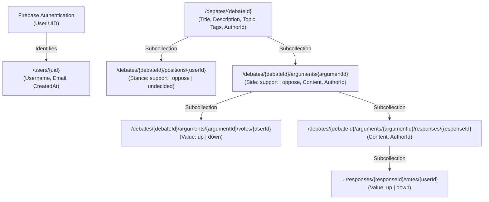
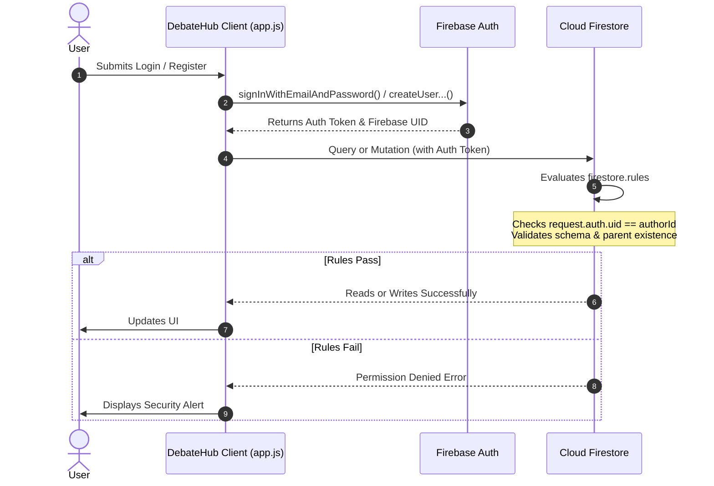
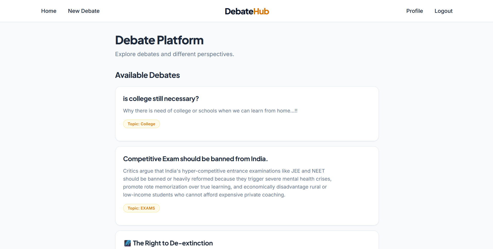
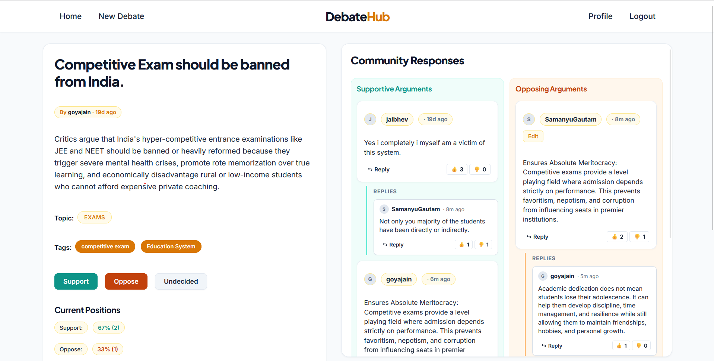
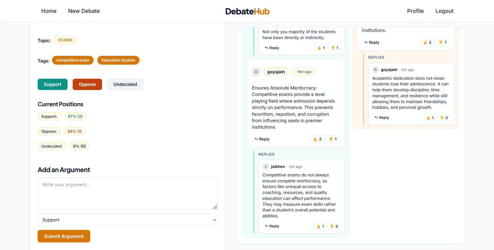
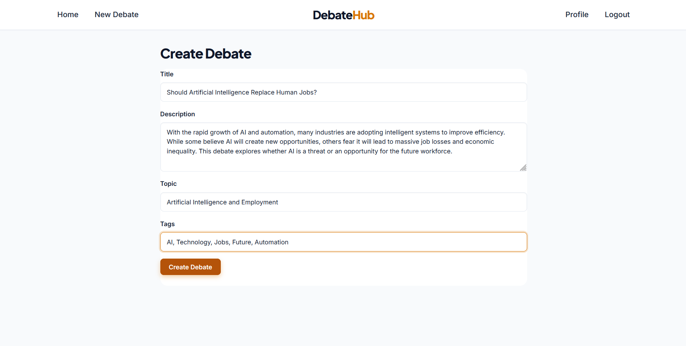
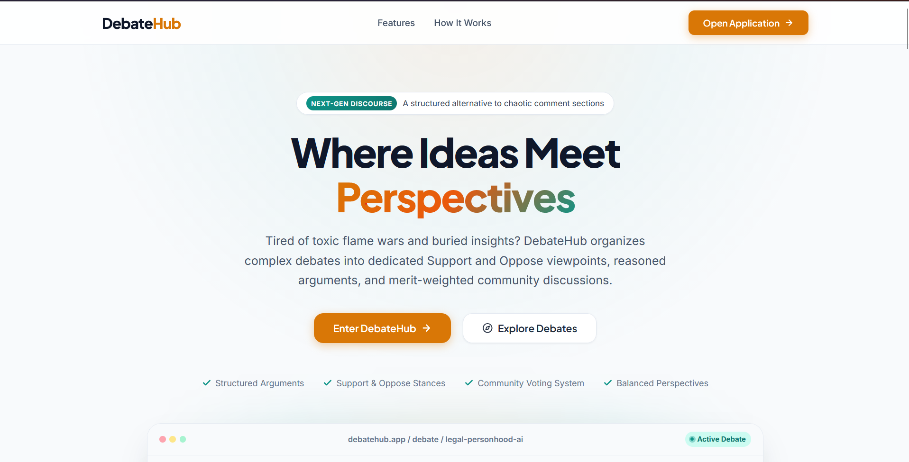

# DebateHub

[](https://firebase.google.com/)
[](https://firebase.google.com/docs/firestore)
[](https://debatehub-b3cd5.web.app)
[](https://developer.mozilla.org/en-US/docs/Web/JavaScript/Guide/Modules)
[](LICENSE)

A structured online discussion and debate platform designed to eliminate chaotic comment sections by organizing viewpoints into balanced perspectives, measurable community stances, and nested counter-arguments. 

Originally built as a client-side prototype using browser `localStorage`, DebateHub has been migrated to a serverless cloud architecture powered by **Google Cloud Firestore**, **Firebase Authentication**, **Firestore Security Rules**, and **Firebase Hosting**.

---

## Live Deployment

The live application is hosted globally on Firebase Hosting with SPA rewrite support for direct route navigation and page reloads:

**Live Demo**: [https://debatehub-b3cd5.web.app](https://debatehub-b3cd5.web.app)  
*Alternative domain: [https://debatehub-b3cd5.firebaseapp.com](https://debatehub-b3cd5.firebaseapp.com)*

---

## Project Overview

DebateHub provides a purpose-built environment for constructive civic and technical discourse. Instead of endless unstructured comment feeds, discussions are arranged into structured arguments and counter-points:

- **Create and Explore Debates**: Publish debate topics with titles, descriptions, categories, and tags, or browse active debates on the feed.
- **Declare Positions**: Choose a debate stance (**Support**, **Oppose**, or **Undecided**) with live aggregated community sentiment percentages.
- **Submit Balanced Arguments**: Post arguments categorized explicitly into **Support** or **Oppose** columns.
- **Threaded Responses**: Reply directly to arguments through nested discussions that preserve context.
- **Community Voting**: Cast upvotes or downvotes on arguments and replies, with toggle-off support and duplicate vote prevention.
- **Author Ownership**: Edit and delete your own debates, arguments, and responses with server-side authorization enforcement.
- **Firebase Authentication**: Register and log in securely using email and password credentials.

---

## Technology Stack

DebateHub operates on a fully serverless architecture without custom backend servers, container runtimes, or traditional REST API frameworks.

### Frontend
- **HTML5**: Semantic elements (`<header>`, `<nav>`, `<main>`, `<article>`, `<section>`, `<details>`) providing structured, accessible markup.
- **CSS3**: Custom design system built with CSS Custom Properties, Flexbox, and CSS Grid layouts.
- **Vanilla JavaScript (ES Modules)**: Modern, browser-native modular architecture (`import`/`export`) running directly in the browser with no build step or bundler.
- **HTML5 History API**: Client-side pushState routing for seamless Single Page Application (SPA) navigation.

### Cloud & Backend Services
- **Firebase Authentication**: Manages user registration, credential validation, session restoration (`onAuthStateChanged`), and secure UID generation.
- **Google Cloud Firestore**: NoSQL document database providing low-latency persistence for profiles, debates, arguments, responses, positions, and votes.
- **Firestore Security Rules**: Strict authorization rules enforcing user ownership, parent-child referential existence checks, data shape validation, and tamper prevention.
- **Firebase Hosting**: Fast, secure global CDN hosting with full SPA rewrites routing all deep links back to `index.html`.

---

## Cloud Architecture

DebateHub uses a hierarchical subcollection structure in Cloud Firestore to reflect discussion relationships naturally:



### Firestore Document Hierarchy

```
users/
└── {uid}                                   # User profiles (read restricted to owner)

debates/
└── {debateId}                              # Top-level debate documents
    ├── positions/
    │   └── {userId}                        # Deterministic ID: 1 position per user per debate
    └── arguments/
        └── {argumentId}                    # Debate arguments (support / oppose)
            ├── votes/
            │   └── {userId}                # Deterministic ID: 1 vote per user per argument
            └── responses/
                └── {responseId}            # Threaded replies under an argument
                    └── votes/
                        └── {userId}        # Deterministic ID: 1 vote per user per response
```

### Architectural Principles

1. **Deterministic Document IDs for Uniqueness**: Storing positions at `.../positions/{userId}` and votes at `.../votes/{userId}` uses the user's Firebase Auth UID as the document ID. This guarantees at the database level that a user can never cast duplicate votes or register multiple stances on the same entity.
2. **Hierarchical Ownership & Referential Integrity**: Arguments live inside their parent debate, responses live inside their parent argument, and votes live inside their respective target.
3. **Serverless CDN Serving**: Static files are cached and delivered via Firebase Hosting edge nodes, while dynamic operations communicate asynchronously directly with Cloud Firestore and Firebase Auth using the Firebase Web SDK v13.3.0.

---

## Authentication and Security

Security in DebateHub is handled through decentralized client authentication paired with Cloud Firestore Security Rules:



### Security Rules Implementation

- **Public Reads**: Debates, arguments, responses, positions, and votes allow public read access (`allow read: if true;`), allowing guests to browse discussions and review sentiment without logging in.
- **Private Profiles**: User documents in `/users/{uid}` are strictly restricted so users can only read their own profile (`request.auth.uid == uid`).
- **Owner-Only Mutations**: Updating or deleting a debate, argument, or response requires `request.auth.uid == resource.data.authorId`. Ownership cannot be reassigned during an update.
- **Relational Integrity Checks**: Creating an argument verifies the parent debate exists using `exists(/databases/$(database)/documents/debates/$(debateId))`. Creating a response verifies both parent debate and argument exist.
- **Input Validation**: Rules enforce required keys (`keys().hasAll(...)`), forbid unexpected properties (`keys().hasOnly(...)`), constrain position values to `['support', 'oppose', 'undecided']`, and restrict vote values to `['up', 'down']`.
- **Client Configuration vs. Secrets**: The Firebase Web API configuration in `js/firebase.js` contains client identifiers, not administrative service account keys. Authorization is exclusively enforced on Google's servers by Firestore Security Rules.

---

## Cloud Migration Summary

The platform was transitioned from synchronous `localStorage` state management to asynchronous Cloud Firestore persistence across seven development phases:

| Module | Persistence Source | Document Path | Key Constraints & Behavior |
| :--- | :--- | :--- | :--- |
| **Authentication** | Firebase Auth | Auth Service | Email/password credentials; session restored via `onAuthStateChanged`. |
| **User Profiles** | Cloud Firestore | `/users/{uid}` | Stores username, email, and registration timestamp; restricted reads. |
| **Debates** | Cloud Firestore | `/debates/{debateId}` | Reverse-chronological listing; author-only updates and deletions. |
| **Arguments** | Cloud Firestore | `/debates/{debateId}/arguments/{argumentId}` | Side classification (`support`/`oppose`); author editing and deletion. |
| **Responses** | Cloud Firestore | `.../arguments/{argumentId}/responses/{responseId}` | Threaded nested replies; author editing and deletion. |
| **Debate Positions** | Cloud Firestore | `/debates/{debateId}/positions/{userId}` | Stance declaration; deterministic ID prevents duplicate stances. |
| **Votes** | Cloud Firestore | `.../votes/{userId}` | Upvote/downvote tracking; clicking active vote toggles it off. |

### Timestamp Normalization
Cloud Firestore stores dates as `Timestamp` objects (`seconds`, `nanoseconds`). DebateHub includes client-side normalizers in each module (`normalizeArgument`, `normalizeResponse`, `normalizePosition`) that safely convert Firestore `Timestamp` instances into standard ISO-8601 strings, preserving compatibility with relative time formatting (`formatTime`) across all views.

---

## Project Structure

```
DebateHub/
├── .firebaserc              # Firebase CLI project association (debatehub-b3cd5)
├── .gitignore               # Ignored local files, credentials, and cache directories
├── favicon.ico              # Platform favicon
├── firebase.json            # Firebase Hosting configuration and SPA rewrites
├── firestore.rules          # Cloud Firestore access control and security rules
├── index.html               # Main SPA entry point and HTML shell
├── landing.css              # Styling for standalone marketing landing page
├── landing.html             # Standalone marketing landing page
├── LICENSE                  # MIT License
├── README.md                # Project documentation
├── css/
│   └── style.css            # Global design system, typography, and layout styles
├── js/
│   ├── app.js               # Event delegation, SPA routing triggers, and bootstrapping
│   ├── arguments.js         # Argument CRUD operations and Firestore integration
│   ├── auth.js              # Firebase Authentication, login, register, and session handling
│   ├── debates.js           # Debate CRUD operations and subcollection cleanups
│   ├── firebase.js          # Firebase SDK initialization and client export
│   ├── positions.js         # Stance selection, statistics calculation, and Firestore sync
│   ├── responses.js         # Nested response CRUD operations and Firestore integration
│   ├── router.js            # Client-side route matching and authentication guards
│   ├── state.js             # Centralized in-memory application state
│   ├── storage.js           # Local storage utilities and state sanitization
│   ├── ui.js                # View rendering templates and HTML sanitization
│   └── votes.js             # Argument and response voting operations and calculations
└── screenshots/             # UI documentation screenshots
```

---

## Screenshots

### Main Debate Discovery
Main debate feed showing topic pills, author metadata, tags, and debate descriptions loaded from Cloud Firestore:

<div align="center">



</div>

---

### Debate Room & Perspectives
Split-panel debate layout displaying title, description, live stance distribution percentages, and side-by-side Support and Oppose arguments:

<div align="center">



</div>

<br/>

<div align="center">



</div>

---

### Debate Creation
Form for authenticated users to publish new debates with validation:

<div align="center">



</div>

---

### Marketing Landing Page
Visual overview explaining the DebateHub workflow and discussion architecture:

<div align="center">



</div>

---

## Local Setup

### Prerequisites
- A modern web browser supporting ES Modules (Chrome, Firefox, Safari, Edge).
- Node.js installed (v18 or higher recommended).
- A local web server (ES modules require HTTP/HTTPS serving and cannot be loaded over `file:///`).

### 1. Clone the Repository
```bash
git clone https://github.com/mrjd-byte/DebateHub.git
cd DebateHub
```

### 2. Configure Firebase
Update `js/firebase.js` with your own Firebase project configuration if deploying to a separate Firebase instance:
```javascript
const firebaseConfig = {
    apiKey: "YOUR_API_KEY",
    authDomain: "YOUR_PROJECT_ID.firebaseapp.com",
    projectId: "YOUR_PROJECT_ID",
    storageBucket: "YOUR_PROJECT_ID.firebasestorage.app",
    messagingSenderId: "YOUR_MESSAGING_SENDER_ID",
    appId: "YOUR_APP_ID"
};
```

### 3. Firebase Console Configuration
1. **Authentication**: In the Firebase Console, go to **Authentication > Sign-in method** and enable **Email/Password**.
2. **Firestore Database**: Create a Cloud Firestore database in production mode.
3. **Security Rules**: Copy the rules from `firestore.rules` and paste them into the **Rules** tab of your Firestore Database in the Firebase Console, then click **Publish**.

### 4. Run Locally

#### Using Python:
```bash
python -m http.server 8000
```
Navigate to `http://localhost:8000`.

#### Using Node.js:
```bash
npx serve .
```

---

## Deployment Instructions

To deploy frontend updates and security rules to Firebase Hosting:

```bash
# 1. Install Firebase CLI globally (if not already installed)
npm install -g firebase-tools

# 2. Authenticate with your Google account
firebase login

# 3. Associate your project
firebase use debatehub-b3cd5

# 4. Deploy hosting only
firebase deploy --only hosting

# (Optional) Deploy updated Firestore security rules via CLI
firebase deploy --only firestore:rules
```

---

## Future Improvements

The following items represent realistic architectural enhancements for subsequent iterations:

- **Cloud Functions for Cascading Deletion**: Automatically delete nested subcollections (`arguments`, `responses`, `votes`, `positions`) in the background when a parent debate is removed, eliminating reliance on client-side deletion loops.
- **Denormalized Profile Lookups**: Cache author display names directly on debates and arguments to eliminate author name resolution limitations for public visitors.
- **Firebase App Check**: Protect Firestore and Authentication endpoints against automated abuse and unauthorized clients.
- **Scalable Vote Aggregation**: Implement distributed counters or Cloud Functions to aggregate vote tallies and stance percentages at scale rather than querying subcollection documents.
- **Full-Text Search**: Implement an external search index (such as Algolia or Typesense) for high-performance title, tag, and content searches.

---

## License

This project is licensed under the [MIT License](LICENSE).
